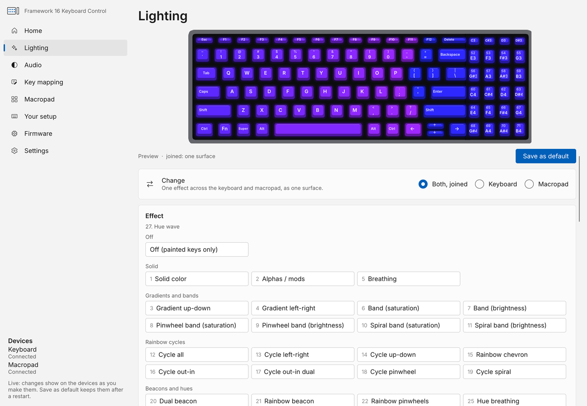
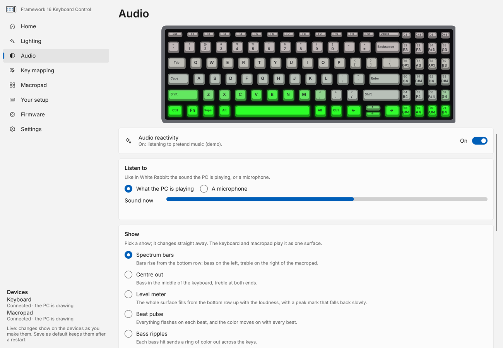
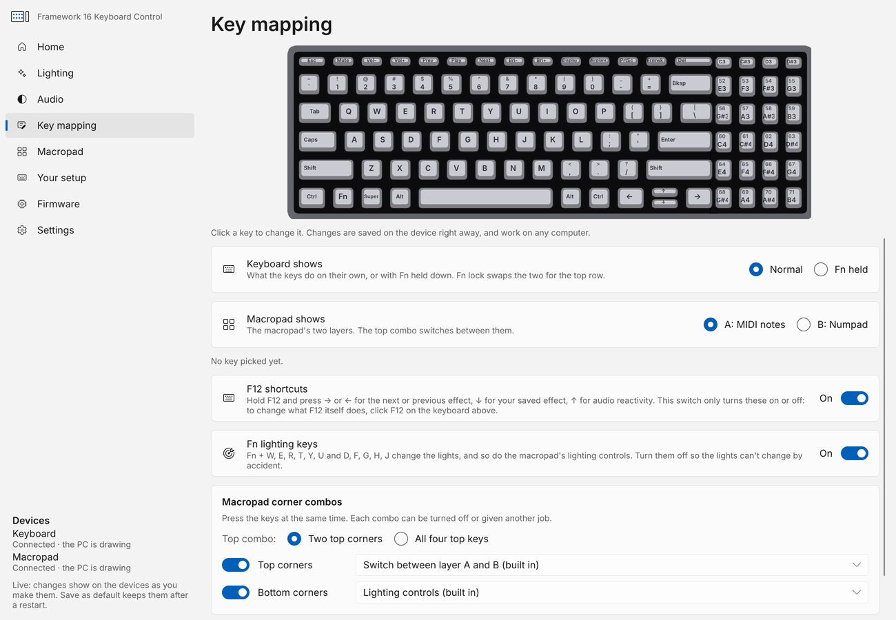
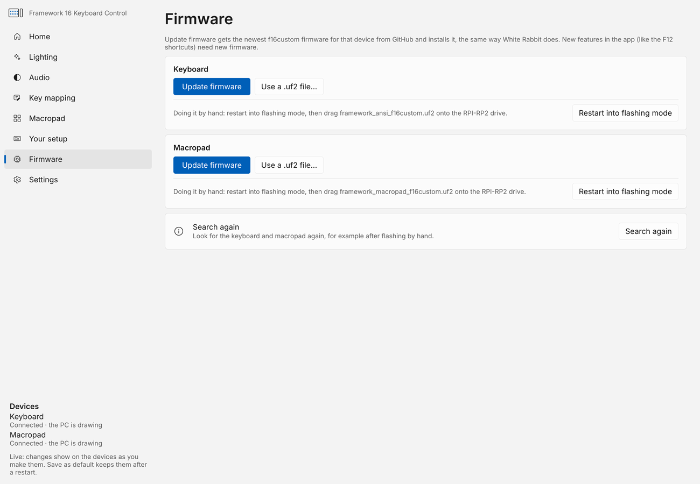
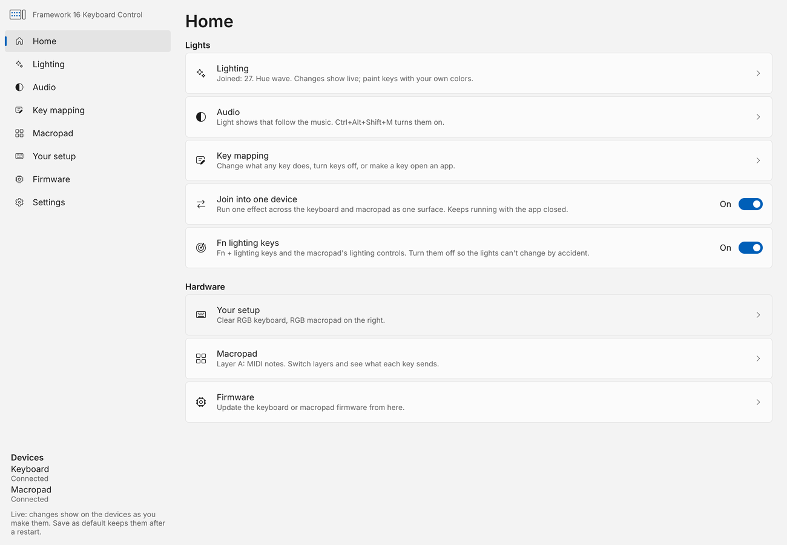

# Framework 16 Keyboard Control

> **This project is finished.** All work on the app is complete, and its features
> have been merged into the White Rabbit LED matrix app. Development continues there:
> **<https://github.com/kingof9x/white-rabbit-framework-matrix>**
>
> **Download the last version (v1.0.3):**
> [Windows installer](https://github.com/kingof9x/framework-16-keyboard-customization/releases/download/v1.0.3/framework-16-keyboard-control-1.0.3-setup.exe)
> · [all release files](https://github.com/kingof9x/framework-16-keyboard-customization/releases/latest)

**Framework 16 Keyboard Control** is a Windows app, plus custom firmware, for the
**Framework Laptop 16** with the **RGB ANSI keyboard** and the **RGB macropad**
(or Framework's numpad). It lets you:

* **Light it your way.** Pick any of the 44 built-in effects and see them live on a
  picture of your keyboard. Run one effect across the keyboard and macropad as a
  single surface, and paint single keys in your own colors.
* **Light it to music.** Audio mode turns what your PC plays, or a microphone, into
  light shows: spectrum bars, a level meter, beat pulses, typing that changes color
  with the music, and more. Ctrl+Alt+Shift+M or F12 + ↑ turns it on and off.
* **Remap keys.** Change what any key does, turn keys off, or make a key open an
  app. Changes are saved on the keyboard and work on any computer.
* **Set up the macropad.** Layer A plays MIDI notes, for Resolume and other VJ or
  music software. Layer B is a numpad. Corner-key combos switch layers.
* **Use shortcuts.** Hold F12 and press → / ← to change the effect, or ↓ to go back
  to your saved one.
* **Update the firmware from the app.** One button downloads the latest firmware
  and installs it, and your remapped keys are kept.
* **Match brightness.** Pull the handles until the keyboard and macropad look equally
  bright.

The app sits in the notification area, can start with Windows, and checks GitHub
for updates.

| Lighting | Audio |
|---|---|
|  |  |
| **Key mapping** | **Firmware** |
|  |  |

## What's in this repository

| Folder | What it is |
|---|---|
| [`app/`](app/) | **Framework 16 Keyboard Control**, the Windows app (Rust + Slint) |
| [`firmware/`](firmware/) | Custom QMK firmware (`f16custom`) for the keyboard and the macropad |
| [`resolume/`](resolume/MAPPING.md) | Key-by-key macropad sheet and how to map it in Resolume |

The rest of this page is the full guide from when the project was active.

## What you get

**Both devices**
* All 44 of Framework's built-in lighting effects, plus a **"PC controlled"**
  effect the app can draw on and an **"Off, painted keys only"** effect.
* **Join into one device:** the keyboard and macropad run an effect as one
  surface, so a sweep starts on the keyboard and finishes at the far edge of
  the macropad. This keeps working with the app closed.
* **Painted keys:** give any key its own color. Painted keys can still react
  to the running effect. They're saved on the device.
* The app can read and set the effect, speed, brightness and color.
* **Fn lighting keys off** (switch in the app, remembered by the device): Fn + lighting
  keys do nothing, so a stray key press can't change the lights during a show.
* VIA and Framework's `qmk_hid` tool still work.

**Keyboard:** same keys and Fn layer as Framework's official firmware, plus
**F12 shortcuts**: hold F12 and press → / ← for the next or previous effect,
↓ to go back to your saved effect, ↑ to turn audio reactivity on or off. They
can be turned off in the app.

**Macropad** (details in [`resolume/MAPPING.md`](resolume/MAPPING.md))
* **Layer A:** 24 MIDI notes (notes 48–71). The pad shows up as a USB MIDI device.
* **Layer B:** Framework's numpad layout. Change any key in the app.
* Press the **two top corner keys together** to switch layers (or, if you
  pick it in the app, **all four top keys**). The whole pad
  flashes cyan (A) or orange (B). The app can make the top corners keep that
  color.
* Press the **two bottom corner keys together** for the lighting controls
  overlay.
* Each combo can be turned off or given another job in the app.
* Brightness matches the keyboard's (Framework's firmware drives the macropad
  LEDs harder).

**App** (Home, Lighting, Audio, Key mapping, Macropad, Your setup, Firmware, Settings)
* A picture of your keyboard and side module at the top of the page, lit with
  the same effect formulas the firmware uses. Changes show on the devices
  **live**; **Save as default** keeps them after a restart.
* **Your setup:** keyboard Clear RGB, Black RGB, or Black with white backlight;
  side module None, RGB macropad, or Numpad, on the left or right. The app
  sees whether a macropad or numpad is plugged in, and remembers the keyboard
  type for each keyboard (by its serial number).
* **Lighting:** change both devices as one surface, or each on its own. All
  44 effects, a full color picker (type or paste a color code), speed and
  brightness, painted keys (steady, brightness following the effect, or
  **tint**: the effect's colors shifted by the painted color), and sliders to
  **match the brightness** of the keyboard and macropad.
* **Audio:** light shows that follow the music the PC plays (spectrum bars,
  centre out, level meter, beat pulse, bass ripples, color wash, strobe, and
  **Typing**: only the keys you press light up, in a color the music picks),
  across the keyboard and side module as one surface. **F12 + ↑** (or
  Ctrl+Alt+Shift+M, White Rabbit's shortcut) turns it on and off (switch it off in
  the Audio page if you like). The sound is measured with White Rabbit's own
  audio code.
* **Key mapping:** change what any keyboard or macropad key does (with or without
  Fn), turn keys off, or make a key **open an app**. Changes are saved on the
  device. Turn the Fn lighting keys off, and set up the macropad's corner
  combos.
* **Macropad:** switch layers and see what each key sends.
* **Firmware:** update a device's firmware from the app (downloads the latest
  release from GitHub, or uses a `.uf2` file you pick), or restart it into
  flashing mode to flash by hand.
* **Settings:** look (follows Windows), keep running in the notification area,
  start with Windows, and check for updates.
* App-drawn effects (wave, rainbow sweep, keypress ripple), hotkey lock, and
  dark or light mode following Windows.

> **Only for the ANSI (US) keyboard and the RGB macropad.** Don't flash the
> keyboard file onto an ISO/JIS keyboard or the numpad. If your ANSI keyboard
> has the white (non-RGB) backlight, the firmware still works for typing, but
> the color features do nothing.

---

## 1. Download the files

Easiest: open **Releases** on this repo's page and download from the newest
release:
* `framework-16-keyboard-control-<version>-setup.exe`: installs the app
  (no administrator rights needed) with a Start menu entry.
* `framework_ansi_f16custom.uf2` and `framework_macropad_f16custom.uf2`: the
  firmware.

The app checks for new releases by itself (Settings → Updates) and can
download and install them.

Test builds also come from GitHub Actions:

1. Open this repo's **Actions** tab.
2. Pick the latest green run of **Build and release**. At the bottom, under
   *Artifacts*, download **firmware-uf2**, **framework-16-keyboard-control-windows**
   and **framework-16-keyboard-control-installer**. (You must be signed in to
   GitHub to download artifacts.) Pull requests also get these as download
   links on the PR.
3. Unzip them. You get:
   * `framework_ansi_f16custom.uf2`: keyboard firmware
   * `framework_macropad_f16custom.uf2`: macropad firmware
   * `framework-16-keyboard-control.exe`: the app on its own
   * `framework-16-keyboard-control-<version>-setup.exe`: the installer

To publish a release: **Actions → Build and release → Run workflow**, and type
a version in the box (for example `1.0`) or leave "next". Pushing a `v*` tag
does the same.

## 2. Flash the firmware

**Easiest: from the app.** Open `framework-16-keyboard-control.exe` →
**Firmware** → **Update firmware** next to the keyboard (or macropad) → *Yes,
update it*. The app downloads the latest release's firmware for that device,
checks it is the right file, restarts the device into flashing mode, copies the
file onto it and waits for it to come back (about 20 seconds). *Use a .uf2
file…* does the same with a file on your PC. Key remaps made in the app are
saved first and put back afterwards. If a device is already sitting in
flashing mode, the Firmware page offers to put firmware on it.

**By hand:** each device must first restart into **flashing mode**. In that mode a USB
drive called **RPI-RP2** appears in File Explorer. While a device is in
flashing mode it doesn't type, so use the touchpad (and an external keyboard
if you need one).

**Enter flashing mode, easy way (works on Framework's official firmware too):**
open `framework-16-keyboard-control.exe` → **Firmware** tab → *Restart keyboard into
flashing mode* (or macropad) → confirm.

**Enter flashing mode, manual way:**
* **Keyboard:** hold **both Alt keys** (left Alt and right Alt) while you
  slide the keyboard module in.
* **Macropad:** hold the key in **row 5, column 2** and the key in **row 4,
  column 3** while you slide the macropad in. Those are the "2" and "6" keys
  on Framework's numpad layout. Rows count from the top, columns from the
  left.

**Then:**
1. Drag the matching `.uf2` file onto the **RPI-RP2** drive.
2. The drive disappears by itself and the device restarts with the new
   firmware. This takes about 5 seconds. Don't unplug it during the copy.
3. Do the other device the same way.

Flashing by hand can reset the device's saved settings (lighting, key
changes): new firmware resets the keymap. That is expected. (*Update firmware*
in the app puts your remapped keys back for you.)

## 3. Go back to Framework's official firmware

1. Download the official files from Framework's releases:
   <https://github.com/FrameworkComputer/qmk_firmware/releases>. Use
   `framework_ansi_default.uf2` for the keyboard and
   `framework_macropad_default.uf2` for the macropad. This project is built on
   their **v0.3.1**.
2. Flash them exactly as in step 2 (the app's flashing-mode button also works
   on official firmware).

## 4. Use the app

1. Run the installer, or double-click `framework-16-keyboard-control.exe`.
   The first time, Windows may say *"Windows protected your PC"* because the
   app isn't signed. Click **More info → Run anyway**.
2. At the bottom left, both devices should show **Connected**. *"Needs the
   f16custom firmware"* means you still need to flash that device.
3. Open **Your setup**: pick which keyboard you have (clear or black keys)
   and which side the module is on. The app finds the macropad or numpad by
   itself, and remembers the keyboard type for that keyboard.
4. The tabs:
   * **Lighting:** under **Change**, pick **Both, joined** (one effect
     across both, as one surface), **Keyboard** or **Macropad**. Pick an
     effect (all 44 built-in effects, "Off, painted keys only", or the three
     app-drawn ones), its color, speed and brightness. Everything shows on the
     devices as you change it. **Save as default** keeps it after a restart.
     Under **Key colors**, pick a color and click or drag across keys to paint
     them (click a painted key again to recolor it). Choose how painted keys
     behave while an effect runs: steady, brighten and dim with it, or
     **tint**. **Match the brightness of the two devices** has LED power and
     red/green/blue sliders per device, and can show plain white on both
     while you adjust.
   * **Audio:** turn on **Audio reactivity** (or hold **F12** and press **↑**),
     pick a show, its **Colors** (automatic, rainbow, green-yellow-red, fire,
     ocean or one color of your choice), **Key presses** (keys you press
     light up, ripple or splash on top of the show) and the sensitivity. Under **Listen to**, pick what the
     PC is playing or a microphone (like in White Rabbit); **Sound now** shows
     whether it hears anything. Turning it off puts back what the Lighting page shows.
   * **Key mapping:** click a key in the picture, then pick **Framework default**,
     **Nothing** (turned off), **A key** (with Ctrl, Shift, Alt or Super if you
     like) or **Open an app** (pick the program). **Keyboard shows** switches
     between what keys do on their own and with **Fn** held. Changed keys are
     orange. The change is saved on the device straight away. Below: the
     **Fn lighting keys** switch and the macropad's **corner combos** (turn
     each off, or give it another job). **Reset all keys** goes back to
     Framework's layout.
   * **Macropad:** switch layer A (MIDI) or B (numpad); click a macropad key in
     the picture to see what it sends. **Layer color on the top corners**
     keeps the corners cyan/orange; off, they follow the effect.
   * **Firmware:** restart a device into flashing mode.
   * **Settings:** the look, **Keep running when closed** (the app waits in
     the notification area so Open an app keys work; right-click its icon to
     quit), **Start with Windows**, and **Check for updates**.
5. When you close the app, devices running an app-drawn effect go back to
   their saved effect. Built-in effects, joined surfaces and painted keys keep
   running without the app.

Black keyboards with a white backlight and the numpad have one white light for
all keys, so they can only change brightness. The app shows them in plain
white.

Try the app without the hardware: run `framework-16-keyboard-control.exe --demo` from a command
prompt to use two pretend devices.

The app needs no admin rights. Without the installer, you can keep the
`.exe` anywhere.

**Open an app keys** send Ctrl+Shift+Alt+F13 to F24. The app turns those into
starting the program, so it must be running (in the notification area is
enough). On another computer without the app those keys do nothing.

**Brightness:** if the macropad looks brighter or dimmer than the keyboard,
use **Match the brightness of the two devices** on the Lighting page.

## 5. Map the macropad in Resolume

See [`resolume/MAPPING.md`](resolume/MAPPING.md) for the key-by-key sheet and
step-by-step MIDI and keyboard mapping.

---

## For tinkerers

* **Building:** done by GitHub Actions on every push and pull request
  (`.github/workflows/`). The firmware workflow runs
  [`firmware/build.sh`](firmware/build.sh) on Ubuntu (Python 3.11 + ARM GCC).
  The app workflow runs the unit tests and builds the `.exe` on a Windows
  machine.
* **How the app talks to the devices:** see
  [`firmware/PROTOCOL.md`](firmware/PROTOCOL.md).
* **Code layout:**
  * `firmware/users/f16custom/`: code shared by both devices (protocol,
    PC-controlled effect, hotkey lock).
  * `firmware/keymaps/ansi/f16custom/`: keyboard keymap (Framework's default
    layout).
  * `firmware/keymaps/macropad/f16custom/`: macropad layers, combos and layer
    LEDs.
  * `app/core/`: effect maths and message encoding, with unit tests.
  * `app/gui/`: the Windows app (Slint + hidapi).
* **VIA:** still works. If you remap a macropad **corner key** in VIA, the
  two-key layer switch stops working for that layer, because the combos match
  the original keys.

## License

The code written for this project is under the [MIT License](LICENSE).
The firmware (`firmware/`) is built from QMK and Framework's QMK firmware, so it
stays under [GPL-2.0-or-later](firmware/LICENSE). The same goes for two app files
derived from QMK: `app/core/src/builtin.rs` (the effect preview) and
`app/core/src/keymap_data.rs` (key tables). Because of those two files, the app
as a whole is distributed under GPL-2.0-or-later. [`LICENSE`](LICENSE) has the
details.
